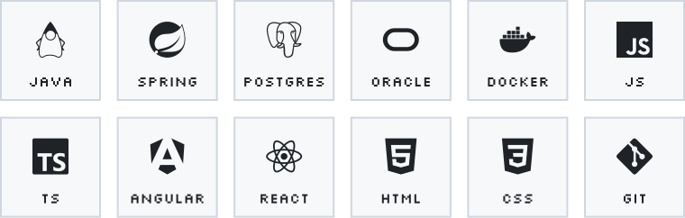
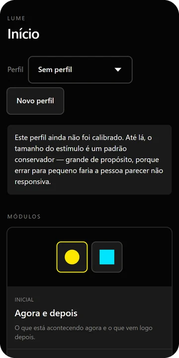

  <picture>
    <source media="(prefers-color-scheme: dark)" srcset="./media/device-dark.svg">
    
  </picture>

  <a href="https://www.linkedin.com/in/joaopedroredondo/">LinkedIn</a> · <a href="mailto:joaopedroredondo@hotmail.com">joaopedroredondo@hotmail.com</a>

<picture>
  <source media="(prefers-color-scheme: dark)" srcset="./media/h-sobre-dark.svg">
  
</picture>

> Sou desenvolvedor Java em Maringá, PR, com mais de 4 anos de experiência em back-end e full stack. Hoje trabalho no ERP da Sabium Sistemas, usado por mais de 1.500 clientes.
>
> Antes de programar, passei 7 anos no comércio físico e no e-commerce de uma loja de bicicletas. Por isso costumo começar pela regra de negócio e só depois ir para o código. Sou bacharel em Engenharia de Software pela UniCesumar e, fora do trabalho, faço projetos como o Prancha Kids e o Lume.

<picture>
  <source media="(prefers-color-scheme: dark)" srcset="./media/h-inventario-dark.svg">
  
</picture>

<picture>
  <source media="(prefers-color-scheme: dark)" srcset="./media/inventory-dark.svg">
  
</picture>

<picture>
  <source media="(prefers-color-scheme: dark)" srcset="./media/h-cartuchos-dark.svg">
  
</picture>

<table>
<tr>
<td width="140" align="center" valign="top">

</td>
<td valign="top">
<b>Prancha Kids</b> 
Prancha de comunicação alternativa para crianças. A criança toca na figura e o celular fala a palavra. São 42 figuras, com vocabulário do dia a dia e da igreja. A posição de cada figura nunca muda, porque a criança memoriza onde cada uma fica. Instala na tela inicial e funciona offline.  
React · TypeScript · PWA 
<a href="https://prancha-kids.vercel.app">Abrir o app</a> · <a href="https://github.com/Joaopredondo/prancha-kids">Código</a>
</td>
</tr>
<tr>
<td width="140" align="center" valign="top">

</td>
<td valign="top">
<b>Lume</b> 
Estimulação visual e cognitiva para baixa visão extrema, usada em ambiente escuro por um cuidador ou terapeuta com a pessoa atendida. Apresenta o estímulo calibrado e registra a resposta. Funciona offline, sem backend e sem conta. Não é dispositivo médico.  
React · TypeScript · Vitest · Playwright 
<a href="https://lume-one-xi.vercel.app">Abrir o app</a> · <a href="https://github.com/Joaopredondo/lume">Código</a>
</td>
</tr>
</table>

<picture>
  <source media="(prefers-color-scheme: dark)" srcset="./media/h-historico-dark.svg">
  
</picture>

- **Sabium Sistemas**, 2025 até hoje. ERP usado por mais de 1.500 clientes. Java, PostgreSQL, Docker, Angular e React.
- **COCARI**, 2023 a 2025. Sistemas da cooperativa, usados por mais de 5 mil pessoas. Java e JavaScript.
- **DB1 Group**, 2022 a 2023. Predize, um hub de mensageria que integra Mercado Livre, Amazon, Americanas e Via Varejo. Java, Spring e React.

Os números e a cobrinha são gerados por <a href="./scripts/build.py">scripts/build.py</a> e atualizados toda semana.
