<picture>
  <source media="(prefers-color-scheme: dark)" srcset="./media/header-dark.svg">
  
</picture>

Desenvolvedor Java em Maringá, PR. Trabalho no ERP da Sabium Sistemas, usado por mais de 1.500 clientes: Java e PostgreSQL no back-end, Angular e React no front-end.

Antes de programar, passei 7 anos no comércio físico e no e-commerce de uma loja de bicicletas. Por isso costumo começar pela regra de negócio e só depois ir para o código.

[LinkedIn](https://www.linkedin.com/in/joaopedroredondo/) · [joaopedroredondo@hotmail.com](mailto:joaopedroredondo@hotmail.com)

## Projetos pessoais

### Prancha Kids

Prancha de comunicação alternativa (CAA) para crianças. A criança toca na figura e o celular fala a palavra. São 42 figuras, com vocabulário do dia a dia e da igreja.

A posição de cada figura nunca muda, porque a criança memoriza onde cada uma fica. As cores das bordas seguem o código Fitzgerald. Instala na tela inicial e funciona offline.

`React` `TypeScript` `PWA`

[Abrir o app](https://prancha-kids.vercel.app) · [Código](https://github.com/Joaopredondo/prancha-kids)

 

### Lume

Estimulação visual e cognitiva para baixa visão extrema, usada em ambiente escuro por um cuidador ou terapeuta com a pessoa atendida. Apresenta o estímulo calibrado e registra a resposta.

Funciona offline, sem backend e sem conta. Não é dispositivo médico.

`React` `TypeScript` `Vitest` `Playwright`

[Abrir o app](https://lume-one-xi.vercel.app) · [Código](https://github.com/Joaopredondo/lume)

 

## Onde trabalhei

- **Sabium Sistemas**, desde 2025. ERP usado por mais de 1.500 clientes. Java, PostgreSQL, Docker, Angular e React.
- **COCARI**, 2023 a 2025. Sistemas da cooperativa, usados por mais de 5 mil pessoas. Java e JavaScript.
- **DB1 Group**, 2022 a 2023. Predize, um hub de mensageria que integra Mercado Livre, Amazon, Americanas e Via Varejo. Java, Spring e React.

## Atividade

<picture>
  <source media="(prefers-color-scheme: dark)" srcset="./media/activity-dark.svg">
  
</picture>

<picture>
  <source media="(prefers-color-scheme: dark)" srcset="./media/languages-dark.svg">
  
</picture>

Os dois gráficos são gerados por <a href="./scripts/metrics.py">scripts/metrics.py</a>.
