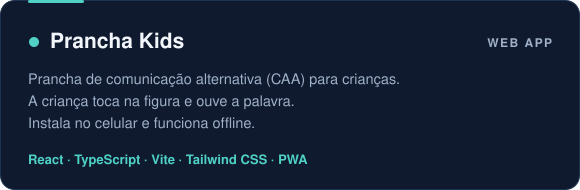
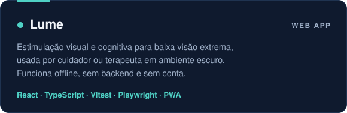
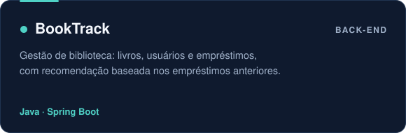

  

  
  
  

## Sobre mim

Desenvolvedor Java com mais de 4 anos de experiência em back-end e full stack. Hoje desenvolvo o ERP da **Sabium Sistemas**, usado por mais de 1.500 clientes.

Antes disso, fui desenvolvedor back-end na **COCARI** e full stack na **DB1 Group**, onde atuei no Predize, um hub de mensageria que integra Mercado Livre, Amazon, Americanas e Via Varejo.

Antes de programar, passei 7 anos no comércio físico e no e-commerce. Isso me ajuda a entender a regra de negócio, e não só o código.

## Stack

  

  

## Projetos em destaque

  
  

  
  

## GitHub em números

  
  

  

## Mais

  

